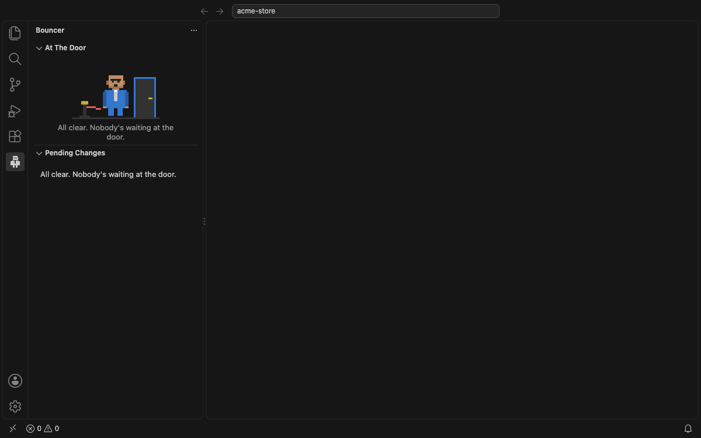
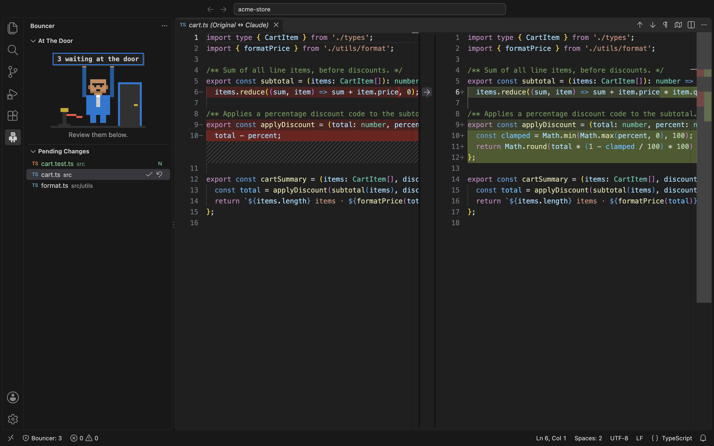

# Bouncer: Review AI Code Changes

> Nothing gets into your code without your OK.

Let Claude Code work without interruptions, then **review everything it changed in one place**.
Bouncer lists every file Claude touched, shows a clear red/green diff, and lets you **keep or undo**
each file, or all of them at once.

- ✅ **Tracks every change**: file edits *and* changes made through shell commands (`sed`, scripts, `mv`, `rm`).
- 🔍 **Diff on click**: the original on the left, Claude's version on the right.
- ↩️ **Undo safely**: restores the exact original bytes, deletes files Claude created, brings back files it deleted.
- 🔒 **100% local**: no account, no telemetry, nothing leaves your machine.

> Bouncer is an unofficial, independent tool. It is not made by or affiliated with Anthropic.

## Works with

| Editor | Install from |
|---|---|
| VS Code | [Visual Studio Marketplace](https://marketplace.visualstudio.com/items?itemName=heybiplab.bouncer) |
| Cursor, Windsurf, Antigravity, VSCodium and other VS Code forks | [Open VSX](https://open-vsx.org/extension/heybiplab/bouncer) |

Requires VS Code 1.90 or newer (or a fork based on it), on macOS, Linux, or Windows.

## Getting started

1. Install Bouncer and open your project folder.
2. Click the **Bouncer** icon in the activity bar, then **Enable Bouncer**.
3. Start a new Claude Code session and ask it to change some files.
4. When Claude finishes you'll see *"Bouncer stopped 3 files at the door."* Click **Review**.
5. Click a file to see the diff. Use ✓ **Keep** or ↺ **Undo** on each file, or **Keep All** / **Undo All** at the top.

### Requirements

- [Claude Code](https://code.claude.com) running in the project folder.
- **Node.js** on your `PATH` (Claude Code runs Bouncer's hook with `node`).
- **git** on your `PATH`, to track changes made with shell commands.

## Features

- **Pending Changes** list, with an `N` badge for new files.
- **Diff on click**. New files diff against an empty document; deleted files show what was removed.
- **Keep / Undo** per file, plus **Keep All / Undo All**. Undo All always asks first, and you're warned
  before undoing a file with unsaved edits.
- **Status bar** count (`🛡 Bouncer: 3`). Click it to jump to the list.
- **"Claude finished" notification** when files are waiting.
- **The Bouncer** himself: a tiny pixel-art doorman who watches while Claude works and holds up a sign
  when files are waiting. Follows your theme and respects reduced-motion settings.

## Commands

All commands are in the Command Palette under **Bouncer:**.

| Command | What it does |
|---|---|
| Bouncer: Enable in this workspace | Adds Bouncer's hooks to `.claude/settings.local.json` and keeps Bouncer's files out of git |
| Bouncer: Disable in this workspace | Removes only Bouncer's hooks |
| Bouncer: Open Diff | Pick a pending file and open its diff |
| Bouncer: Keep / Undo | Pick a pending file and keep or undo it |
| Bouncer: Keep All / Undo All | Act on every pending file |

## How it works

- Before Claude edits a file, a Claude Code hook saves the original to `.bouncer/snapshots/`. This happens
  only the first time per file, so you always compare against the version from before Claude started.
- For shell commands, Bouncer compares the project before and after each command and saves the original of
  every changed, created, or deleted file. It uses git internally with a private index, so your staging
  area, branches, and history are never touched.
- **Keep** forgets the saved original. **Undo** restores it.
- The hook never blocks or slows down Claude's decisions. Errors go to `.bouncer/hook.log`.

## Privacy

Bouncer runs entirely on your machine. It has no telemetry, makes no network requests, and needs no
account. Saved originals stay in your project's `.bouncer/` folder, which is kept out of git.

## Good to know

- Bouncer's hooks live in your personal `.claude/settings.local.json`, so teammates are never affected.
- After an extension update, Bouncer updates its hooks automatically the next time it activates.
- Shell-command changes are tracked in git repositories only, and files ignored by `.gitignore` are
  skipped. Each shell command takes about 0.2 s longer while Bouncer compares the project.
- In a multi-root workspace, Bouncer uses the first folder.

## Troubleshooting

**Claude changed files but nothing shows up**
- Start a **new** Claude Code session after enabling. Claude Code loads hooks when a session starts.
- Check that `node` (and `git`, for shell commands) work in a terminal.
- Look in `.bouncer/hook.log` for errors.

**Bouncer says it isn't enabled**: run **Bouncer: Enable in this workspace**.

## Uninstalling

Run **Bouncer: Disable in this workspace** in each project first to remove its hooks, then uninstall.
If you forget, the leftover hooks are harmless and do nothing. You can also delete the `.bouncer/` folder.

## Feedback

Found a bug or have an idea? [Open an issue](https://github.com/heybiplab/bouncer/issues)
or email [dev@heybiplab.in](mailto:dev@heybiplab.in).

## Roadmap

Per-hunk keep/undo, grouping changes by prompt, change summaries and stats, sensitive-file warnings.

## License

[MIT](LICENSE)
